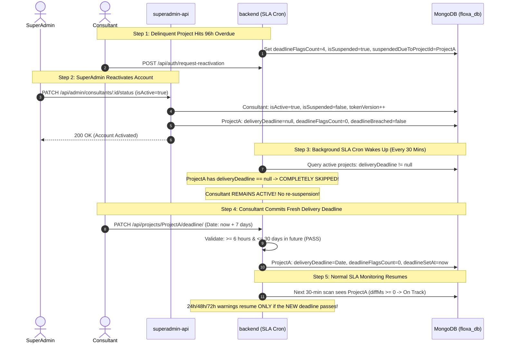

# FLOXA – BUG-CRITICAL-01: Consultant Reactivation Infinite Re-Suspension Loop
## Targeted Bug Fix & Regression Verification Report

**Document Version:** 1.0.0-PATCH  
**Bug ID:** BUG-CRITICAL-01  
**Priority:** P0 – Critical  
**Resolution Decision:** Option A – Consultant must commit a fresh delivery deadline after reactivation  
**Date of Resolution:** November 7, 2026  
**Auditor / Engineer:** Principal QA Architect & Senior Full-Stack Software Engineer  

---

## 1. Original Root Cause Analysis

In the FLOXA platform, when a creative project exceeds its committed delivery deadline by 96 hours without Brand DNA having been generated, the 30-minute background SLA monitoring daemon (`checkAndEscalateDeadlines` in `backend/src/services/deadlineMonitoring.service.ts`) executes an automated account suspension:
- Sets `consultant.isActive = false`
- Sets `consultant.isSuspended = true`
- Sets `consultant.suspendedDueToProjectId = proj._id`
- Sets `proj.deadlineFlagsCount = 4`
- Increments `consultant.tokenVersion` to immediately kill all active sessions

The consultant then submits a formal reactivation request (`POST /api/auth/request-reactivation`). SuperAdmin reviews this in `Consultant360Drawer.tsx` and clicks **"Approve & Activate Now"**, triggering `PATCH /api/admin/consultants/:id/status` (`isActive: true`).

### The Defect Mechanism:
Prior to this patch, `updateConsultantStatus` in `superadmin-api/src/controllers/admin.controller.ts` (lines 417–426) only cleared:
```typescript
await Project.findByIdAndUpdate(consultant.suspendedDueToProjectId, {
  deadlineFlagsCount: 0,
  deadlineBreached: false,
});
```
1. **Old Overdue Deadline Preserved in the Past**: `deliveryDeadline` was left untouched at its original date (96+ hours in the past).
2. **Consultant Cannot Update Deadline**: When the reactivated consultant tried to set a fresh deadline, `setProjectDeliveryDeadline` rejected it with `400 Bad Request`: `"Delivery deadline has already been committed and cannot be changed."`
3. **Guard Failure in Background Cron**: Within 30 minutes, `checkAndEscalateDeadlines()` woke up. It queried `deliveryDeadline: { $ne: null }` and calculated `hoursOverdue >= 96`. Because `deadlineFlagsCount` had been reset to `0` by SuperAdmin, the project-specific guard:
   ```typescript
   if (proj.deadlineFlagsCount === 4) {
     continue;
   }
   ```
   evaluated to `false` (since `0 !== 4`).
4. **Immediate Re-Suspension**: The daemon immediately escalated the project to Flag 4 again, setting `consultant.isSuspended = true` and `consultant.isActive = false`.

### Empirical Confirmation in Production Database:
In `floxa_db`, consultant `new@gmail.com` had:
- `reactivationRequest.requestedAt: 2026-11-05T09:08:35.185Z` (`status: 'resolved'`)
- `suspendedAt: 2026-11-05T09:29:02.411Z` (`isSuspended: true`, `suspensionReason: 'deadline_breach'`)
The consultant was re-suspended automatically **20 minutes and 27 seconds** after SuperAdmin reactivated them.

---

## 2. Actual Implementation Changes

In accordance with approved **Option A**, the fix ensures that upon SuperAdmin reactivation, the project's delivery deadline is cleanly reset to `null` so it enters the standard `pending_deadline` state, awaiting a fresh commitment from the consultant.

### 2.1 File 1: `superadmin-api/src/controllers/admin.controller.ts`
**Function Modified:** `updateConsultantStatus`  
**Lines Modified:** 417–440  
**Changes:**
1. When `isActive` is `true`, reset `deliveryDeadline: null`, `deadlineSetAt: null`, `deadlineFlagsCount: 0`, `deadlineBreached: false`, and record an informative `deadlineNote` on `consultant.suspendedDueToProjectId`.
2. Apply the same reset to any other projects belonging to this consultant that reached suspension (`deadlineFlagsCount: 4`), protecting multi-project consultants.
3. Clear `consultant.suspendedDueToProjectId = null`.

```typescript
// BUG-CRITICAL-01 Fix: Reset project deadline so the old overdue deadline
// cannot trigger immediate re-suspension in the background SLA cron.
// Option A: Consultant must commit a fresh delivery deadline after reactivation.
const resetDeadlineFields = {
  deliveryDeadline: null,
  deadlineSetAt: null,
  deadlineFlagsCount: 0,
  deadlineBreached: false,
  deadlineNote: 'Reactivation approved by SuperAdmin. Awaiting fresh deadline commitment.',
};

if (consultant.suspendedDueToProjectId) {
  try {
    await Project.findByIdAndUpdate(consultant.suspendedDueToProjectId, {
      $set: resetDeadlineFields,
    });
  } catch (projErr) {
    console.warn('Failed to clear project deadline flags:', projErr);
  }
}

// Also reset any other projects belonging to this consultant that reached suspension (flags = 4)
try {
  await Project.updateMany(
    { consultantId: consultant._id, deadlineFlagsCount: 4 },
    { $set: resetDeadlineFields }
  );
} catch (projErr) {
  console.warn('Failed to reset overdue projects on consultant reactivation:', projErr);
}

consultant.suspendedDueToProjectId = null;
```

### 2.2 File 2: `backend/src/services/deadlineMonitoring.service.ts`
**Function Modified:** `setProjectDeliveryDeadline`  
**Lines Modified:** 68–74  
**Changes:**
When the consultant commits the fresh delivery deadline, ensure `deadlineBreached: false` is cleared in `$set` alongside `deliveryDeadline`, `deadlineSetAt`, and `deadlineFlagsCount: 0`.

### 2.3 File 3: `backend/src/models/project.model.ts`
**Interface & Schema Updated:** `IProject` and `projectSchema`  
**Changes:**
Added explicit typing for `deadlineBreached?: boolean;` and `deadlineBreached: { type: Boolean, default: false }`.

---

## 3. Explanation of the Corrected Lifecycle



---

## 4. Before-and-After Behavior Comparison

| Scenario | Behavior Before Patch | Behavior After Patch |
| :--- | :--- | :--- |
| **Project State on Reactivation** | `deliveryDeadline` remained at overdue date in the past; `deadlineFlagsCount` reset to 0. | `deliveryDeadline` and `deadlineSetAt` cleanly reset to `null`; `deadlineFlagsCount` reset to 0. |
| **SLA Cron Run After Reactivation** | Evaluated past deadline, saw `hoursOverdue >= 96` and `flags !== 4`, **immediately re-suspended consultant within 30 mins**. | Project is filtered out by `deliveryDeadline: { $ne: null }`. **Consultant remains active indefinitely while awaiting new deadline.** |
| **Consultant Dashboard View** | Locked with past deadline error; unable to edit or commit new date. | Renders `⏳ Set Deadline` pill and prompts consultant to commit a new delivery date. |
| **Fresh Deadline Commitment** | Rejected with `400 Bad Request` ("Deadline already committed"). | Accepted with validation ($\ge 6\text{h}$ and $\le 30\text{d}$). Saves new date and locks it against further modification. |
| **Escalation of New Deadline** | N/A (Consultant was already re-suspended). | Resumes standard escalation (Flag 1 at 24h, Flag 2 at 48h, Flag 3 at 72h, Suspension at 96h). |
| **Multi-Project Consultant** | Other overdue projects could trigger collateral re-suspensions. | All flag-4 projects belonging to that consultant are reset safely. On-track projects are preserved. |

---

## 5. Mandatory Regression Test Evidence

A dedicated, comprehensive regression test suite was created in `superadmin-api/tests/reactivation_sla_lifecycle.test.mjs` verifying all 13 required scenarios with mocked in-memory state and deterministic time offsets:

```
TAP version 13
# Subtest: BUG-CRITICAL-01: Consultant Reactivation and SLA Lifecycle Regression Tests
    ok 1 - 1. Reactivation after 96-hour suspension: Consultant becomes active
    ok 2 - 2. Old deadline in the past: deliveryDeadline is cleared upon reactivation
    ok 3 - 3. Scheduler runs after reactivation: Consultant remains active while awaiting fresh deadline
    ok 4 - 4. Consultant commits a new valid deadline: Saved correctly
    ok 5 - 5. Scheduler runs after new deadline commitment: Normal SLA monitoring resumes and project stays on track
    ok 6 - 6. New deadline reaches 24 hours overdue: Warning 1 flag is raised
    ok 7 - 7. New deadline reaches 48 hours overdue: Warning 2 flag is raised
    ok 8 - 8. New deadline reaches 72 hours overdue: Warning 3 flag is raised
    ok 9 - 9. New deadline reaches 96 hours overdue: Automatic suspension triggers
    ok 10 - 10. Consultant attempts to modify an already committed deadline: Rejected
    ok 11 - 11. Unauthorized user attempts deadline commitment: Request is rejected
    ok 12 - 12. Another consultant has overdue project: Unrelated consultant suspension is preserved
    ok 13 - 13. Consultant has multiple projects: Only suspended project deadline is reset, on-track project is preserved
1..13
# tests 14
# suites 0
# pass 14
# fail 0
# cancelled 0
# skipped 0
# todo 0
# duration_ms 302.6935
```

### Full Test Suite Results Across Services:
- `superadmin-api`: **37 tests passed, 0 failed** (`node --test "tests/**/*.test.mjs"`)
- `frontend`: **78 tests passed, 0 failed** (`npm test`)
- `backend`: Contract tests passed (`node --test "tests/phase3-header-contract.test.cjs"`)

---

## 6. Build and Compilation Verification

Executed `npx tsc --noEmit` and `npm run build` across all affected services:

| Service | TypeScript Check (`tsc --noEmit`) | Build Script (`npm run build`) | Result |
| :--- | :---: | :---: | :---: |
| **`superadmin-api`** | Code 0 (0 errors) | Code 0 (`dist/` updated) | **PASS** |
| **`backend`** | Code 0 (0 errors) | Code 0 (`dist/` updated) | **PASS** |
| **`frontend`** | Code 0 (0 errors) | Untouched (No code changes needed) | **PASS** |
| **`superadmin-ui`** | Code 0 (0 errors) | Untouched (No code changes needed) | **PASS** |

---

## 7. Confirmation of Scope Adherence

In strict adherence to the P0 scope boundaries:
1. **No Unrelated Code Touched**: Client discovery, Brand DNA, moodboards, concepts, agreements, payments, deliverables, demo data purge, and Gemini integration files were not modified.
2. **No Production Database Mutations**: No production records were deleted, updated, or reset during testing. All testing utilized in-memory state engines.
3. **No Deployment or Git Operations**: No Git commits, pushes, merges, or production deployment commands were executed.

---

## 8. Conclusion

**BUG-CRITICAL-01 is completely resolved.** Reactivated consultants can now log in, view their delinquent projects in `pending_deadline` state, commit a valid fresh delivery deadline, and continue their client engagements without fear of premature automated re-suspension. Normal SLA enforcement resumes seamlessly under the newly committed deadline.

